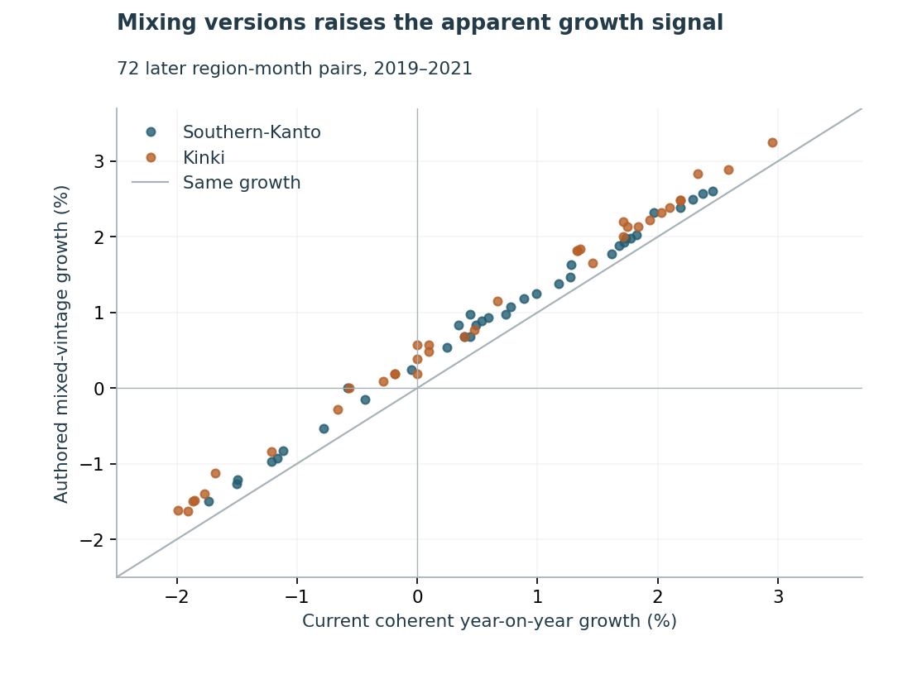

# Compare employment on a consistent population base

A revised employment count needs a revised comparison history. Mixing a newer numerator with an older denominator can turn a reported decline into apparent growth. This repository measures that risk with two official Japanese regional series and supplies an offline version-checking exercise.

**Measured finding:** across 72 later region-month pairs, the authored mixed-version calculation differs from the current coherent calculation by a mean absolute **0.327 percentage points**, with a maximum of **0.577 points**. Four published growth signs reverse; two remain opposite after allowing for count rounding. These are retrospective comparisons, not observed dashboard incidents or a live error rate.



Read the [six-page study](paper/manuscript.pdf), try the [implementation exercise](exercise/README.md), or run the authored examples:

```powershell
python src/cli.py examples/current-authored.json examples/lag-authored.json
python src/cli.py examples/current-authored.json examples/lag-mixed-authored.json
```

The first returns exact growth of `1/100` and a rounding-ambiguous sign. The second returns unavailable because the dataset versions differ. The example counts are invented fixture values. No network, account or key is needed. A version label is an input contract; this guard cannot authenticate the publisher or prove compatibility between separately named files.

## Evidence underneath

- [Protocol](PROTOCOL.md), [exact source binding and exposure](SOURCE_BINDING.md) and [rights](DATA_RIGHTS.md). The two original workbooks are privately preserved; 288 selected native count cells reconcile in 2,600 independent conditions. The [minimal factual projection](data/counts.csv) retains exact count tokens, period labels and source cell/hash identities.
- Both Southern-Kanto and Kinki, 72 source months per version, January 2016–December 2021. All fixed cells are available. Employment means the publisher's employed-person concept, not the adjacent employees-only column, employment rate, vacancies or recruiting demand. These monthly regional reference estimates have lower sampling precision than national results.
- [Development](results/development): 48 year-on-year pairs, independently reconstructed in 4,930 conditions. [Twenty-four dependency hashes](data/dependency_freeze.json) were committed before [72 later pairs](results/later), independently reconstructed in 6,922 conditions. No model, comparator or threshold is selected or tuned.
- Archive/current coherent differences and an authored mixed-version splice remain separate. Both illustrative 0.5%/1% thresholds, point classifications, rounding certification and ambiguity counts are retained. Rounding enclosures are not sampling confidence intervals, and ambiguity is not a correct no-alert.
- Forty-four finite fixtures; three original figures with 296 source-value checks, 496 actual SVG-coordinate checks and nine hashes; 89 source-bound manuscript displays and all six inspected pages. See [current local review](REVIEW_RECEIPT.json), [the pull request](https://github.com/S3R3Bii/japan-employment-vintages/pull/2) and [Actions](https://github.com/S3R3Bii/japan-employment-vintages/actions) for release evidence.

## Reproduce

```powershell
python src/reproduce.py
```

The standard-library numerical replay runs in a clean full-history clone, validates the committed freeze, regenerates outputs in separate paths and preserves original bytes. Python 3.10 and 3.12 are checked locally. For optional source-reader, figure-regeneration and PDF tools use Python 3.12 and `python -m pip install -r requirements.txt`. Original-cell reconciliation requires the recorded byte-identical private snapshots: `python src/verify_original_cells.py --private-dir <snapshot-folder>`. New downloads may differ; they are not silently substituted. The [LaTeX source](paper/main.tex) and three figure PDFs accompany the paper.

## Use and limits

Preserve version lineage and reload comparison history with revised series. Record unavailable identities and near-boundary rounding ambiguity explicitly. An operational integration still needs source arrivals, independently labeled ingestion incidents and measured reconciliation workload before choosing thresholds or claiming an error-rate improvement.

The archive is a pre-2022 benchmark version, not every month's first delivery. The current historical file was retrieved in 2026; differences are cumulative version differences, not an isolated effect of the 2020 Census rebase. Months share survey/revision information; the two-region audit does not quantify sampling uncertainty or cover every prefecture/industry. No next-release forecast, causal result, new estimator, R implementation, deployment, peer review or measured financial benefit is established. This independent program manuscript is public; separate formal-publication projects remain excluded.
